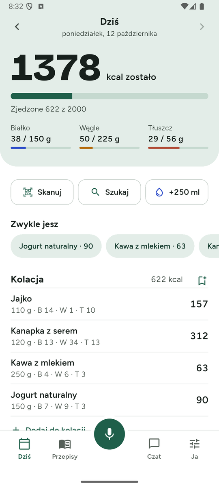
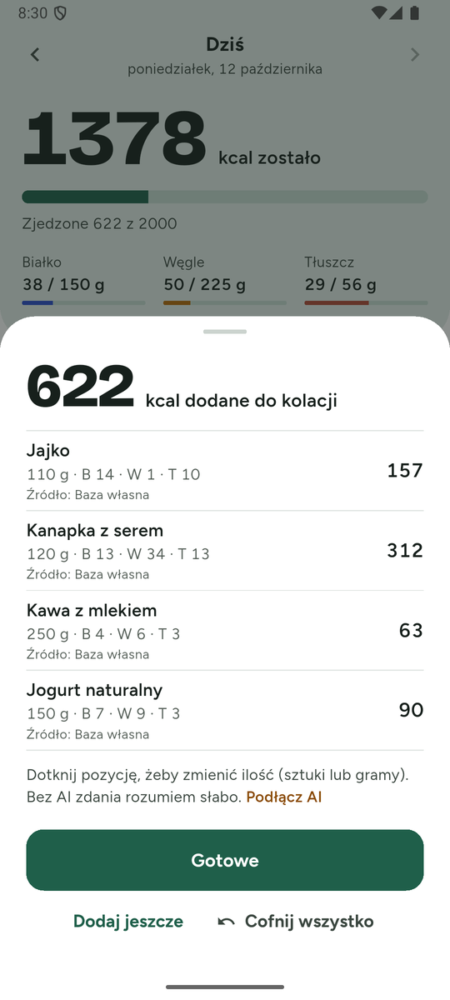
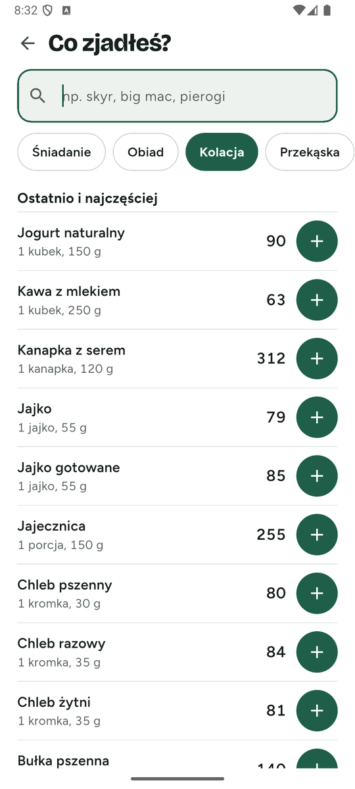
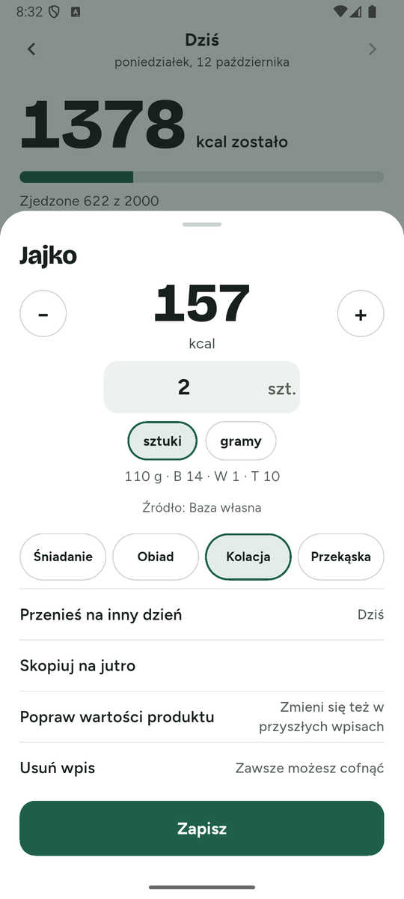
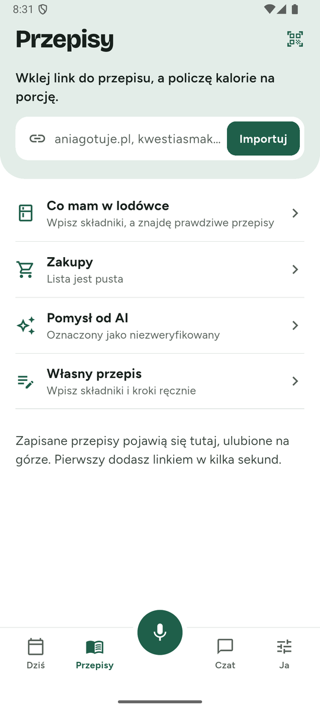
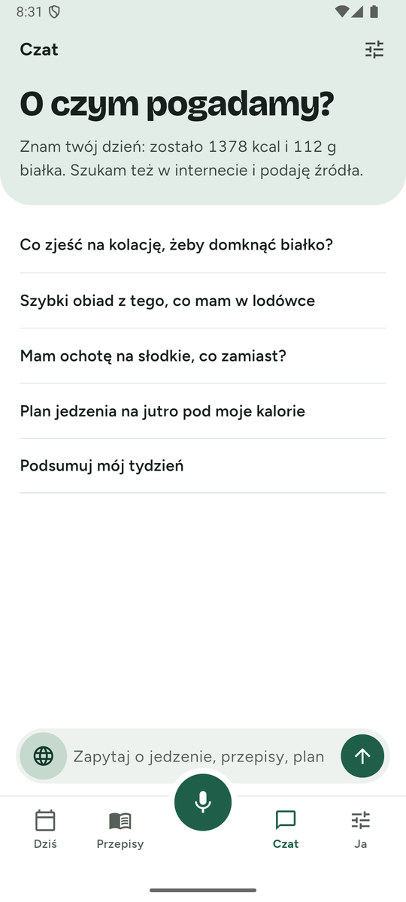
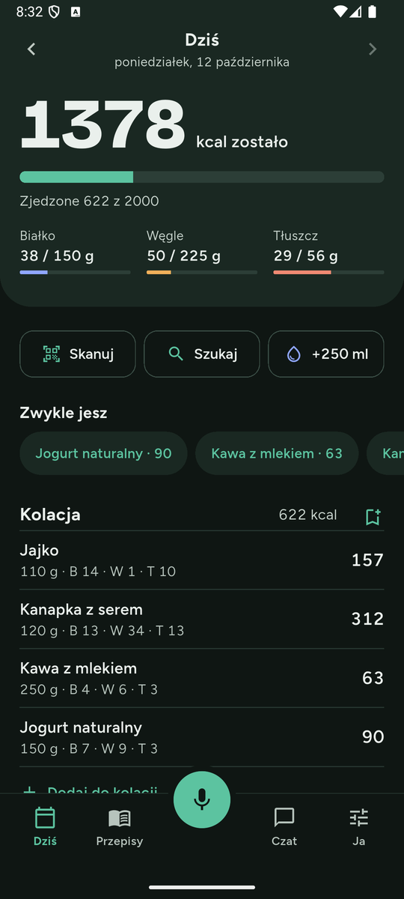
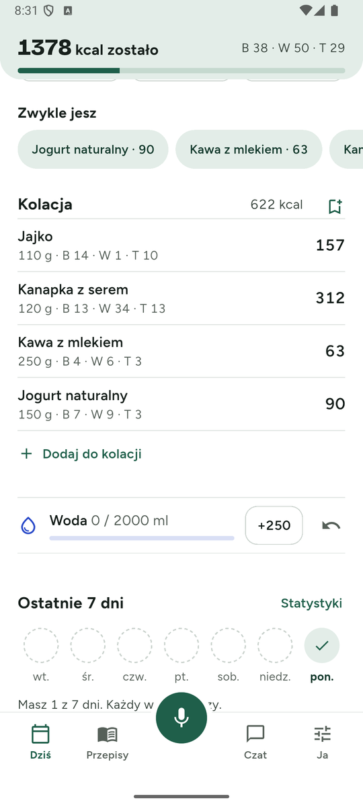

# Dietownik

A diet tracker for people who hate diet trackers. Say what you ate, scan a barcode or snap a label, and it's logged. Built for laziness and ADHD: one big number, almost no taps, no guilt.

> The app UI is in **Polish**. This README is in English.

<p align="center">
  
  
  
  
</p>
<p align="center">
  
  
  
  
</p>

## Why

Most trackers want you to search a database, pick a serving, pick a meal and repeat. Dietownik inverts that:

- **Speak or type a sentence** ("two eggs, a cheese sandwich and a coffee with milk") and everything is logged at once, with an undo button instead of confirmation dialogs.
- **One big number** on the home screen: kcal left today. The header collapses to a compact bar when you scroll.
- **No guilt.** Empty days are dashed circles, not red marks. A "today I'm not counting" switch keeps a day out of averages and streaks.

## Features

**Logging**
- Voice and text entry with an AI parser (any OpenAI-compatible or Anthropic API, or a local on-device model). Works without AI for simple lists ("2 jajka, 200 g ryżu, dwie łyżki masła").
- One-tap serving from search results (the `+` button), "Usually eat" chips, copy yesterday, save a meal as a named set you can say out loud.
- Continuous barcode scanner (Open Food Facts, ~20 000 popular Polish products bundled for offline use).
- **Photo of a nutrition label**: a vision model reads name, macros per 100 g and ingredients; you confirm, and it is saved for next time.
- AI estimate for anything missing, optionally backed by a web search so the numbers come with a source.
- "Eyeball" entries (kcal only, macros left empty on purpose) and a per-entry **value source** (own database, Open Food Facts, web page, or "AI estimate, no source").
- Edit amounts in pieces *or* grams, move or copy entries, correct a product's values for future entries.

**Planning**
- Recipes: import from a link (schema.org data), create your own, or ask the AI. Cook for several days and log one portion.
- "What's in my fridge": searches real recipes on the web and shows a **match percentage computed from ingredients, not by the AI**. Missing items go to the shopping list in one tap.
- Shopping list you can fill by voice ("shopping eggs, cheese, butter").
- Weekly calorie mode, water tracker, weight chart, 7-day stats, meal reminders that only fire if the meal isn't logged yet.

**Chat**
- Chat about your food with the context you allow (today, 90 days of history, goals, fridge, recipes), with numbered web sources, a recipe card (`Ate it` / `Save recipe`) and per-source privacy switches.

**Other**
- Android home-screen widget (kcal left + Speak / Scan / Eyeball).
- Light and dark theme, Bricolage Grotesque + Figtree.
- Local backup/restore (JSON), CSV product import.
- Rough, on-device AI cost estimate with a monthly limit.
- Update prompt that appears only when a newer release exists (see below).

## Install

1. Open the [latest release](../../releases/latest) on your phone.
2. Download `Dietownik-<version>-arm64.apk` (almost every modern phone). Use `armv7` only for old 32-bit devices.
3. Open the file and allow installing from your browser/file manager if Android asks.

Updating is the same: install the new APK over the old one, data stays. All releases are signed with the same key, so updates work without uninstalling. (A debug build has a different signature and must be uninstalled first, so back up via *Ja → Zapisz kopię zapasową*.)

### Updates

On launch (after a few seconds) the app asks GitHub for the latest release and compares **only the version number** with the installed one. It prompts when, and only when:

- a release newer than the installed version exists,
- it has not checked in the last 12 hours,
- you did not press *Później* (silent for 3 days),
- you did not press *Pomiń tę wersję* for that version.

Offline, rate-limited or no releases: it stays silent. *Ja → Sprawdź aktualizacje* checks on demand. The prompt opens the APK matching your CPU in the browser.

## AI setup

The app works without AI, but sentences, label photos and chat need a model. *Ja → Dostawca API* has presets with default models: DeepSeek, Gemini, OpenAI, Anthropic, Groq, Mistral, OpenRouter, Ollama (LAN) and a custom endpoint. Paste a key; it is stored in the Android keystore. Optionally set a separate vision model for label photos.

On-device models can be downloaded in *Ja → Modele na telefonie* (LiteRT-LM through `flutter_edge_ai`).

**Web search** (chat, missing products):
- With no key the app tries DuckDuckGo and falls back to Polish Wikipedia. This can be unreliable (DuckDuckGo blocks bots).
- With a key it uses [Tavily](https://tavily.com) (free monthly quota, no card) or Brave. Brave removed its free API tier in 2026.

## Privacy

All data (entries, recipes, weight, chat history) lives in a local SQLite database. Nothing is sent anywhere unless you connect an AI provider or search service, and then only the text or image of the request plus the chat context you enabled. There is no analytics and no account. Speech recognition uses Android's recognizer, which on most phones goes through Google.

## Build from source

Requirements: Flutter 3.47+ (Dart 3.12+), Android SDK (minSdk 30 because of LiteRT-LM).

```bash
git clone git@github.com:GrzegorzSzczepanek/Dietownik.git
cd Dietownik
flutter pub get
flutter run                      # debug on a device/emulator
flutter test                     # unit tests
```

Release builds need a signing key. Create one and a git-ignored `android/key.properties`:

```properties
storePassword=...
keyPassword=...
keyAlias=dietownik
storeFile=dietownik-release.jks   # relative to android/app
```

```bash
keytool -genkeypair -keystore android/app/dietownik-release.jks -alias dietownik \
  -keyalg RSA -keysize 2048 -validity 10000
flutter build apk --release --split-per-abi
```

Keep the keystore safe: without it you cannot publish updates that install over existing copies.

Other tooling:

```bash
dart run flutter_launcher_icons                   # regenerate the launcher icon from assets/icon
python3 tool/build_off_pack.py off.csv.gz 20000   # rebuild the bundled product pack
```

### Releasing

1. Bump `version:` in `pubspec.yaml` (the update check compares `major.minor.patch`).
2. `flutter build apk --release --split-per-abi`, name the files `Dietownik-<version>-arm64.apk` / `-armv7.apk`.
3. Create a GitHub release tagged `v<version>` and attach both APKs. The in-app updater finds them by the `arm64` / `armv7` part of the file name.

## Project layout

```
lib/
  ai/             LLM clients, provider presets, diet prompts, chat, usage estimate
  core/           theme tokens (light/dark), update service
  data/           SQLite, built-in foods, bundled product pack loader
  domain/         models, meal resolver, parsers, CSV import
  features/       screens (today, search, scanner, recipes, chat, settings, ...)
  services/       Open Food Facts, recipe import/search, web search
  notifications/  meal reminders
android/          Kotlin home-screen widget, signing config
design/           high-fidelity mockups and the implementation hand-off
tool/             scripts (product pack builder)
```

## Data sources and licences

- Barcode data: [Open Food Facts](https://world.openfoodfacts.org), © its contributors, ODbL. The bundled pack and the on-demand lookups come from it.
- Built-in whole foods are rounded typical values (USDA FoodData Central and Polish nutrition tables, entered by hand). Fast-food and chain items are **approximate** and are shown with `~`. You can import exact figures via CSV.
- Fonts: Bricolage Grotesque and Figtree, SIL Open Font License (texts in `assets/fonts`).
- Recipes are fetched only from links you give it or when you search; they remain the property of their authors.
- Calorie and macro figures are estimates and not medical advice.

The project itself does not have a licence file yet.

## Design

`design/` contains the mockups (`*.dc.html`, 390×844) and `design/HANDOFF.md`, the spec the UI was implemented from.
